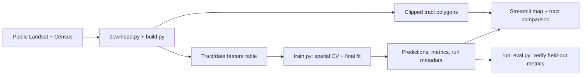

# CoolBlocks: Long Beach land surface temperature

A small, reproducible proof of concept: public Landsat data → tract-level features →
spatial model validation → predictions → an interactive Streamlit map.

The current dataset contains **338 tract/date observations across 114 city-clipped Census tracts**
on July 12, August 5, and August 29, 2023. Census tracts are neighborhood proxies, not named
neighborhoods. Surface temperature is **not air temperature, heat index, or personal exposure**.

## A. Run the included demonstration

Use Python **3.11 or newer** (verified on Linux with Python 3.12). From a terminal:

```bash
git clone https://github.com/Kyzaqu/coolblocks.git
cd coolblocks
python3 -m venv .venv
source .venv/bin/activate
python -m pip install -e .
python -m streamlit run app/streamlit_app.py
```

Open the local URL printed by Streamlit, normally `http://localhost:8501`.
No Landsat download, model training, account, or API key is needed to run this demonstration.
Dependency installation needs Internet access; browser map tiles and map JavaScript/CSS also load
from external services. This is not a fully offline browser application.

If you already cloned the repository, the Make equivalent is `make setup` followed by `make app`.
The Makefile uses `.venv/bin/python`, so activation is optional. On Windows, use
`py -3 -m venv .venv`, activate with `.venv\Scripts\Activate.ps1` in PowerShell, then use the
same `python -m pip` and `python -m streamlit` commands. Conda is optional: `make setup-conda`,
`conda activate coolblocks`, then `make app PYTHON=python`.

### What is included

The demo uses the existing application and its normal file paths:

| Included file | Purpose | Approximate size |
|---|---|---:|
| `data/processed/units.geojson` | 114 real Census tracts clipped to Long Beach | 64 KB |
| `results/predictions.parquet` | 338 observed/predicted tract-date rows and associated features | 32 KB |
| `results/run_metadata.json` | Source provenance, configuration, package versions, metrics, fold audit | 28 KB |

These are actual outputs of `make data features train`, not fabricated sample data. The two small
boundary/prediction files are explicitly included in Git; there is no duplicate demo dataset or
separate demo application. Published CSV evaluation outputs are also included. Raw imagery,
intermediate features, and the serialized model remain local and are recreated by the full workflow.

### Try a sample result

1. Keep **Predicted temperature** selected and choose **Aug 29, 2023**.
2. Click a colored tract, or use the details dropdown to choose **Census tract 5440.02**.
3. The rounded results are predicted **48.4°C**, observed **46.5°C**, and error **+1.9°C**.
   These are historical surface temperatures, not current air temperatures.
4. Switch to **Observed temperature** and **Prediction error**, then use **Compare this tract**
   and choose a second tract under **Tract B**.
5. Expand **About the model, data quality, and limitations** for evaluation, coverage,
   spectral indices, limitations, and the selected date's CSV download.

Error in the app/download is **predicted minus observed**. Evaluation CSVs instead label their
signed residual as **observed minus predicted**; MAE and RMSE are unaffected by that sign convention.

## B. Reproduce the ML experiment

After installation, run these commands **from the repository root**, in order:

```bash
make data       # Download public Census boundaries and cropped Landsat rasters
make features   # Mask unsuitable pixels and aggregate by tract/date
make train      # Compare models with spatial CV, refit, and save all predictions
make eval       # Check saved held-out scores and summarize tract/date errors
```

Without Make, use the same active virtual environment:

```bash
python -m coolblocks.data.download --config configs/config.yaml
python -m coolblocks.features.build --config configs/config.yaml
python -m coolblocks.models.train --config configs/config.yaml
python -m coolblocks.evaluation.run_eval --config configs/config.yaml
```

The download needs Census, Planetary Computer, and Azure Blob Storage access; signing of public
Landsat asset URLs is automatic. Three fixed scene IDs, coverage thresholds, the predictor list,
model list, seed, and relative paths are in [configs/config.yaml](configs/config.yaml).
Changing the study area requires a new raw cache directory. After downloading,
`make features train eval` runs without network access. Running this workflow regenerates the
included demo outputs at their existing paths; it does not create another copy of the dataset.

The original environment and source fingerprints are recorded in
[results/run_metadata.json](results/run_metadata.json). Dependencies are declared in
[pyproject.toml](pyproject.toml) and [environment.yml](environment.yml). Versions are not locked:
use the recorded versions on Python 3.12 when investigating numerical differences. Upstream
product changes or package/platform differences may prevent bit-for-bit reproduction; compare
row counts, tract/date keys, and numeric values within tolerance, not only binary file hashes.

To recheck the included evaluation without downloading or training, run `make eval`.
To run verification:

```bash
make test lint
```

The suite checks the bundled real outputs against published predictions/metrics and exercises
all dates/views, tract inspection, and comparisons with simulated map clicks. These checks run
on a clean checkout without imagery downloads. Small artificial test fixtures are used only for
software behavior tests, never as reported environmental results. Browser interaction tests do
not substitute for a visual check of external tile/CDN availability.

## Submission verification

Verified on Linux / Python 3.12.3 using a clean tracked-file checkout and a new virtual environment:

- `make setup` and `pip check` succeed; no additional packages or services are required.
- `make test lint`: **27 tests pass, none skipped**, and lint passes, using only included outputs.
- The Streamlit server returns HTTP 200 for its health endpoint and application page. AppTest
  exercises all three dates/views, simulated tract clicks, inspection, and two-tract comparison.
- Fresh `make data features train eval` reproduces 338 rows, 114 geometries, spatial folds,
  and numeric prediction-table values/pooled metrics within `1e-12` of the included run. Fresh
  Census archive and cropped Landsat asset checksums match the original source manifest.
- Credential-pattern and local documentation-link checks found no issues.

A dependency emits a Pydantic deprecation warning; it does not fail the checks. Browser appearance
and external tile/CDN availability were not visually verified. These checks are separate from the
scientific evaluation below; they do not establish additional predictive accuracy.

## How it works



The included outputs enter directly at the map stage; reproduction starts at public source data.

1. [`download.py`](src/coolblocks/data/download.py) resolves three scene IDs pinned in
   [`config.yaml`](configs/config.yaml), downloads Census 2023 generalized place/tract boundaries,
   and caches only the Landsat raster windows around Long Beach. A manifest records source URLs,
   scene timestamps, and SHA-256 checksums (file fingerprints).
2. [`build.py`](src/coolblocks/features/build.py) clips Los Angeles County tracts to Long Beach,
   removes empty and line-only intersections, applies Landsat scaling and quality masks, and
   averages LST, NDVI, NDBI, and NDWI over the **same pixels** in each tract/date. Observations
   need at least 30 valid pixels and 50% valid coverage. Coverage includes water in its denominator;
   water pixels cannot contribute to the means.
3. [`train.py`](src/coolblocks/models/train.py) compares mean, linear, and Random Forest models.
   The existing five-fold `GroupKFold` approach holds out entire tracts, including all their dates.
   Only NDVI, NDBI, and NDWI enter the model. It saves every held-out prediction, selects the model
   with lowest mean fold MAE, and refits that model on all observations.
4. [`run_eval.py`](src/coolblocks/evaluation/run_eval.py) checks the spatial audit and recomputes
   pooled held-out metrics, then summarizes the selected model's errors by tract and date.
5. [`streamlit_app.py`](app/streamlit_app.py) reads the outputs without training. Choose a date,
   start with spatially held-out temperature predictions, then switch to observed LST or
   prediction error. Click a tract for its temperatures and signed error, or choose it from
   the details dropdown. Use **Compare this tract** to start a two-tract comparison.
   Predicted and observed maps share one fixed temperature scale across dates; error uses
   a blue-to-red scale centered on zero (**predicted minus observed**). Model metrics,
   spectral indices, data quality, limitations, and CSV downloads are in the collapsed
   **About the model, data quality, and limitations** section. These are same-date
   estimates, not forecasts.

This keeps the original masking, spectral indices, model constructors, metrics, and spatial splitting.
NLCD, demographic/SVI ingestion, prioritization, LightGBM, and intervention scenarios are outside
this minimal workflow. The existing prioritization module is retained but unused by the app.

## Verified results

Five-fold spatial validation; mean ± sample standard deviation across folds:

| Model | MAE (°C) | RMSE (°C) | R² |
|---|---:|---:|---:|
| Mean baseline | 2.100 ± 0.188 | 2.748 ± 0.291 | −0.010 ± 0.016 |
| Linear regression | 1.989 ± 0.154 | 2.652 ± 0.280 | 0.050 ± 0.150 |
| Random Forest | 1.984 ± 0.269 | 2.594 ± 0.395 | 0.079 ± 0.264 |

Random Forest is selected by mean fold MAE. Its improvement over linear regression is tiny;
these results do not establish a meaningful superiority. Low R² indicates limited predictive
explanation. The same folds are used for selection and reporting, so this is exploratory evaluation.

See [fold metrics](results/cv_metrics_by_fold.csv), [pooled metrics](results/pooled_oof_metrics.csv),
[run provenance and fold memberships](results/run_metadata.json). Pooled metrics combine all held-out rows;
they differ from averaging fold scores. No future-date accuracy has been measured.

## Outputs and temperature labels

| File | Meaning |
|---|---|
| `data/raw/MANIFEST.json` | Sources, scene timestamps, cached-file checksums |
| `data/processed/features.parquet` | Observed LST and predictor means per tract/date |
| `data/processed/coverage.csv` | All candidate tract/dates and acceptance status |
| `data/processed/units.geojson` | City-clipped tract polygons |
| `results/oof_predictions.csv` | All models' **spatially held-out** predictions used for evaluation |
| `results/predictions.parquet` | Observations, selected model's fitted estimates, and held-out estimates |
| `results/model.joblib` | Final fitted model, ordered predictor names, and settings |
| `results/error_by_*.csv` | Selected model's held-out errors by date and tract |
| `data/processed/neighborhoods.geojson` | Latest date's joined observations/estimates, for export |

`observed_lst_celsius` is the mean USGS satellite retrieval, not a thermometer reading.
`oof_predicted_lst_celsius` is predicted without training on that tract.
`predicted_lst_celsius` in `predictions.parquet` comes from the final model fitted on all rows:
its `prediction_type` is **fitted_in_sample** and it is not used to report accuracy or shown on the map.
All estimates use same-date satellite predictors; they are not forecasts.

Only the small demo boundaries and prediction table are included from generated geographic/binary
outputs. Raw imagery, other processed datasets, and the serialized model are ignored by Git.
Small CSV results and run metadata are retained for review. There is no database or hosted backend.

## Scientific boundaries

This prototype has three clear-sky summer dates, approximate Census boundaries, coarse thermal
resolution, and no temporal holdout, field validation, spatial buffer, uncertainty model, or equity
analysis. It does not estimate causal benefits from trees or justify investment rankings.
See the [data sheet](docs/data_sheet.md), [model card](docs/model_card.md),
[evaluation plan](docs/evaluation_plan.md), and [limitations](docs/limitations.md).

## Team

Kevin Luu, Fristine Sok, Eric Lee, Yasasvi Kotagiri
